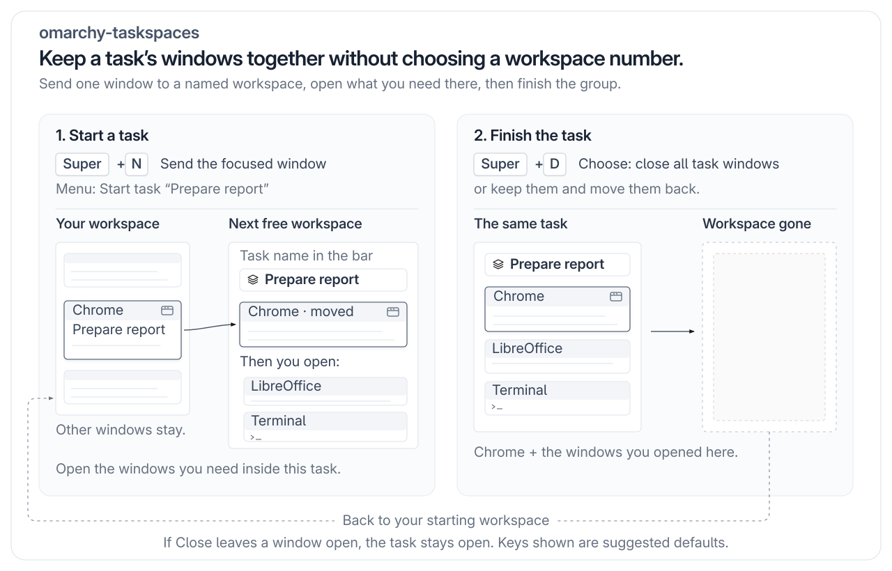

# Taskspaces

Start a task with one key, finish it with one key: you never pick a workspace number or maintain a workspace.
Send a window to a named task workspace, open what you need there, then close the task's windows or move them back.



Example: send one window to a task, then open the other windows you need inside it. Finish handles the windows on that task workspace.

## Why

Picking workspace numbers, remembering what lives where, and tidying up are work of their own, especially when an urgent task interrupts. A task is not tied to one app: an email window can belong to one task and the next to another, so fixed app-to-workspace rules do not fit.

## How it works

1. **Start:** Press your send key (`Super+N` by default). Accept the name suggested from the window title with Enter; the window moves to the task's workspace and you follow it. Silent send (`Super+Alt+N` by default) lets you stay where you are.
2. **Work:** Open the windows you need inside the task. The bar shows the task name; there are no workspace notes or shortcuts per workspace to remember.
3. **Finish:** Press your finish key (`Super+D` by default), then choose Close or Keep. The menu shows where kept windows will go. Close sends normal close requests; a window left open keeps the task unfinished and triggers a notification.

On a numbered workspace, **Turn workspace S into a task…** names it without moving windows; finishing with Keep makes it an ordinary numbered workspace again. Setup lets you choose free keys for these actions. See [Bindings](#bindings).

## Status and requirements

**Alpha (0.1.0), Omarchy Quattro (4.0.0.alpha) only.** Tests use mock commands; Quattro desktop use, Hyprland's removal of empty workspaces, and app save prompts on close are untested. The browser helper supports Chromium-family browsers only.
See [Status](#status) for runtime tools and limits.

## Install

Repository: `omarchy-taskspaces`; plugin id: `tithi-stack.taskspaces`; command: `taskspaces`. Installing alone does not add shortcuts.

1. Add the plugin and choose Yes when asked to enable it. Omarchy shows a warning and asks you to confirm before it clones.
   ```bash
   omarchy plugin add https://github.com/tithi-stack/omarchy-taskspaces
   ```
2. Set up your shortcuts. Run this one line, then choose **Yes, add them** to allow the change:
   ```bash
   "${XDG_CONFIG_HOME:-$HOME/.config}/omarchy/plugins/tithi-stack.taskspaces/bin/taskspaces" setup
   ```
   Setup offers send, silent send and finish, plus an optional **new browser window here** shortcut for a supported browser. It backs up your bindings first, checks the reload, and restores the backup if verification fails. It reports the keys you chose. **Show me the lines first** previews the exact block; **No, I'll add them myself** leaves your file alone.

The plugin never touches your Hyprland files unless you run `taskspaces setup` and choose Yes. Installing or enabling it does not run setup.

If a shortcut is already taken, setup names what uses it and offers a free alternative. You can also pick your own key or skip that shortcut. Silent send starts with your chosen send key plus Alt; if that is taken, you can choose another. Existing shortcuts are never replaced.

Updates: `omarchy plugin update tithi-stack.taskspaces`. The bindings point at the helper inside the plugin folder, so you do not change them after an update.

Already have setup's three Taskspaces shortcuts? Run setup again to add only the optional browser shortcut. If a `taskspaces browser` shortcut already exists in your bindings file or live shortcuts, setup reports its key and changes nothing.

## Bindings

Setup is the primary path. After the optional PATH link, run `taskspaces setup` to check whether shortcuts are already installed. `taskspaces setup --dry-run` asks the same questions and prints the block after Yes, without writing or reloading.

These are suggested defaults. Use the actual keys you chose in setup or in your manual bindings. After manual changes, run `hyprctl reload` and `hyprctl configerrors`.

| Suggested default | Action | Command |
|---|---|---|
| `SUPER + N` | Send the focused window to a task, then follow it | `taskspaces send` |
| `SUPER + ALT + N` | Send the focused window to a task, and stay here | `taskspaces send --silent` |
| `SUPER + D` | Finish the current task | `taskspaces finish` |
| `SUPER + ALT + B` (optional) | Open a new browser window here | `taskspaces browser` |

`taskspaces --help` prints usage. `taskspaces --version` prints `0.1.0`.

### Conflict check

Setup compares modifier masks and keys with `hyprctl binds -j` and checks Omarchy's stock Lua bindings before suggesting an alternative. If it cannot read live shortcuts, it stops without writing. For manual setup, inspect `hyprctl binds -j` yourself and choose free keys; do not remove someone else's shortcut to make room.

## Optional

Move the widget to the center of your bar:

```bash
omarchy bar move tithi-stack.taskspaces --section center
```

Put the helper on your `PATH`, if `~/.local/bin` is on it:

```bash
ln -s "${XDG_CONFIG_HOME:-$HOME/.config}/omarchy/plugins/tithi-stack.taskspaces/bin/taskspaces" ~/.local/bin/taskspaces
```

### Manual Lua bindings

Paste these suggested defaults into `${XDG_CONFIG_HOME:-$HOME/.config}/hypr/bindings.lua` only after checking that the keys are free. Adjust the helper path if you use a custom `XDG_CONFIG_HOME`:

```lua
-- taskspaces: send the focused window to a task, or finish the task
local taskspaces_bin = os.getenv("HOME") .. "/.config/omarchy/plugins/tithi-stack.taskspaces/bin/taskspaces"
o.bind("SUPER + N", "Send window to task", taskspaces_bin .. " send")
o.bind("SUPER + ALT + N", "Send window to task (stay here)", taskspaces_bin .. " send --silent")
o.bind("SUPER + D", "Finish task", taskspaces_bin .. " finish")
-- Optional: check that the key is free before uncommenting.
-- o.bind("SUPER + ALT + B", "New browser window here", taskspaces_bin .. " browser")
```

## Usage

1. Focus the window you want to move. For example, an email window titled `Reply to the team - Mail`.
2. Press your send key (`Super+N` by default). A menu opens.
3. The first row, **Start task "Reply to the team"**, uses the suggested name. Its grey line says `name suggested from the window title` (with ` · whole window (all tabs)` added for Chrome). Press Enter to accept it, or choose **Start task with my own name…** to enter your own.
4. The window moves to a new workspace named after the task, and you follow it. A notification says `Task "Reply to the team" → workspace N`.

To open a browser inside the task, use the optional new-browser-window shortcut; the stock launcher can take you to a browser window elsewhere. See [Opening more windows in a task](#opening-more-windows-in-a-task).

The bar shows the task icon followed by `Reply to the team`.

Press your finish key (`Super+D` by default) to finish. With one window, choose **Close 1 window and finish**, **Keep 1 window and finish**, or **Cancel**. With more windows, the rows show the count and use `windows`. The keep row says `returns to workspace S · nothing is closed` in grey, or `stays in workspace S · nothing is closed` for a task made from a numbered workspace. `S` is the workspace number.

Choose one. If you choose Close and an app keeps its window open, for example to ask you to save, the task stays unfinished. Taskspaces waits up to 30 seconds. It stops early after 10 seconds with no windows closing if no new window has appeared, then names up to three windows still open. Windows closed or opened while the menu was open are checked again before the choice runs.

To send without following, press your silent send key (`Super+Alt+N` by default) in step 2. The full menu rows and naming rules are in [How Taskspaces works](docs/how-it-works.md).

On a numbered workspace, **Turn workspace S into a task…** names the current workspace without moving its windows; finishing that task with Keep leaves the windows there and restores the workspace's numbered name. Its grey line says `windows stay where they are`. Suggested names are capped at 35 characters so the first row always reads `Start task "<name>"`. Names you type are capped at 40 characters. Quotes and backslashes are removed from task names; names taken from an app are cleaned too. A name made only of digits gets `Task ` in front, for example `Task 2`.

The menu uses these icons: 󰐗 for the suggested name, 󰏫 for typing or renaming, 󰉗 for naming the current workspace, 󰉒 for sending to another workspace, 󰖭 for Close, 󰐃 for Keep, and 󰁍 for Cancel. The menu uses the Nerd Font icons included with Omarchy. Existing-task and workspace choices spell out `workspace <id>` in grey.

Finishing removes the task record. For a task started by moving a window, kept windows return to its starting workspace only if it still has the same name and is not another task. Otherwise they go to workspace 1. If workspace 1 is also in use by a task or has a custom name, Taskspaces uses the lowest unused workspace number. Focus follows the windows. Tasks started from a scratchpad also return to workspace 1, subject to that same safety check.

## Opening more windows in a task

Omarchy's stock browser launcher can hand a request to the running Chromium browser; when given a URL, it also focuses an existing browser window, which can take you back to that window's workspace. `taskspaces browser` requests a fresh window here with an existing profile, offering a profile picker only when there is more than one; it works on any workspace and leaves the stock `Super+Shift+Return` shortcut untouched.

Supported Chromium browsers: Chromium, Google Chrome (`google-chrome-stable`), Brave, Brave Origin, and Microsoft Edge (`microsoft-edge-stable`). With no saved profiles, it reports `No browser profiles found.`; open your browser normally first to create one.

Setup offers this as a separate optional shortcut before the final confirmation. It starts with `Super+Alt+B` (B for browser); if taken, it offers `Super+Alt+W`, then `Super+Alt+C` when free, your own key, or a skip. The stock browser shortcut stays in place. Removing setup's shortcuts with `taskspaces setup --remove` also removes its optional browser line.

## Uninstall

1. Remove setup's shortcuts before deleting the plugin:
   ```bash
   "${XDG_CONFIG_HOME:-$HOME/.config}/omarchy/plugins/tithi-stack.taskspaces/bin/taskspaces" setup --remove
   ```
   Choose **Yes, remove them**. Only the managed block is removed, after a backup. If you pasted the manual snippet, setup tells you which binding lines to delete yourself; also delete its `taskspaces_bin` line, then run `hyprctl reload`.
2. If you made the optional PATH symlink, remove it: `rm ~/.local/bin/taskspaces`.
3. Remove the plugin. This disables it, then deletes its folder:
   ```bash
   omarchy plugin remove tithi-stack.taskspaces
   ```
4. Optional: delete leftover task records. They live in the runtime directory, which your session normally clears.
   ```bash
   rm -rf "${XDG_RUNTIME_DIR:?}/taskspaces"
   ```

## Troubleshooting

- **The key does nothing.** Cause: another Taskspaces action holds the lock, and the helper exits silently when it cannot get it. Or the bind did not load. Fix: wait a second and press again. If it still does nothing, run `hyprctl configerrors`.
- **Notification: "No window focused".** Cause: no window had focus when you pressed your send key. Fix: focus a window and press it again.
- **Notification: "This workspace isn't a task".** Cause: your finish key ran on a plain workspace. Fix: switch to the task workspace, then press your finish key (`Super+D` by default).
- **Notification: "Dispatch failed: <reason>".** Cause: Hyprland rejected a command, or did not reply ("no reply from Hyprland"). Fix: run `hyprctl version`. If that fails, Hyprland is not reachable from this shell. If it works, the reason after the colon is Hyprland's reply to the rejected command.
- **Notification: "Missing required command: <names>".** Cause: the listed commands are not on `PATH`. Fix: install them, then check each with `command -v <name>`.
- **No notification appears, and nothing happens.** Cause: neither `omarchy-notification-send` nor `notify-send` is installed, so messages go to stderr, which a keybinding does not show. Fix: run the same command from a terminal to see the message.
- **`XDG_RUNTIME_DIR is required`, in a terminal only.** Cause: the variable is not set in that shell. Fix: run the command from your desktop session.

## FAQ

- **Does it change my Hyprland config?** Only when you run setup and choose Yes. It edits only your Lua bindings file, backs it up outside your config folder, and can undo its managed block with `taskspaces setup --remove`.
- **Does it use the network or sudo?** No. It runs only local commands. See [SECURITY.md](SECURITY.md).
- **Can I keep using numbered workspaces?** Yes. A task takes the lowest unused number while it exists. See [Workspace numbers](docs/how-it-works.md#workspace-numbers).
- **Does it work with a legacy `.conf` Hyprland config?** See [Status](#status) for compatibility; the setup instructions use Lua.
- **Is it in a plugin marketplace?** Not yet.

## Status

See [Status and requirements](#status-and-requirements) for release status and untested desktop behavior.

Legacy `.conf` support is unverified. A task takes a workspace number. Finish can close windows; it never force-kills processes or answers save prompts. Focus returns to the safe return workspace described in [Usage](#usage).

| Requirement | Used for |
|---|---|
| Hyprland, with `hyprctl` on `PATH` | Moving, renaming, focusing, and closing windows |
| `jq`, `python3`, `flock`, `bash`, GNU coreutils | Script logic, name rules, and a lock so one action runs at a time |
| `omarchy-menu-select`, `omarchy-menu-input` | Menus and the name prompt. These ship with Omarchy. |
| `omarchy-notification-send` (preferred) or `notify-send` (fallback) | Notifications. Without either, messages go to stderr. |

Check your Omarchy version with `cat /usr/share/omarchy/version`. The targeted release supplies the plugin system and Lua bindings.
Send and finish also need `XDG_RUNTIME_DIR` set; setup and browser do not. See [Troubleshooting](#troubleshooting).

## More

- [How Taskspaces works](docs/how-it-works.md): menus, naming rules, finish behavior, and state files
- [CONTRIBUTING.md](CONTRIBUTING.md): tests and how to propose changes
- [SECURITY.md](SECURITY.md): what the plugin runs, and how to report a vulnerability
- [CHANGELOG.md](CHANGELOG.md): release history

## License

MIT. See [LICENSE](LICENSE).
